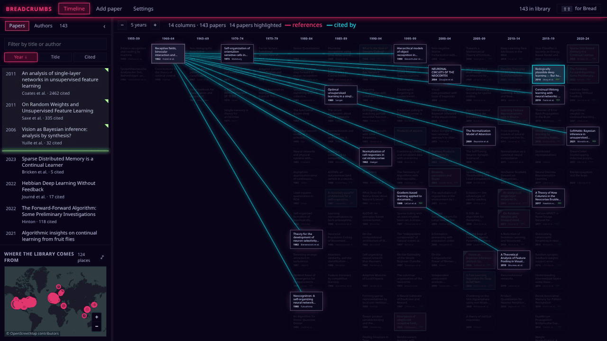
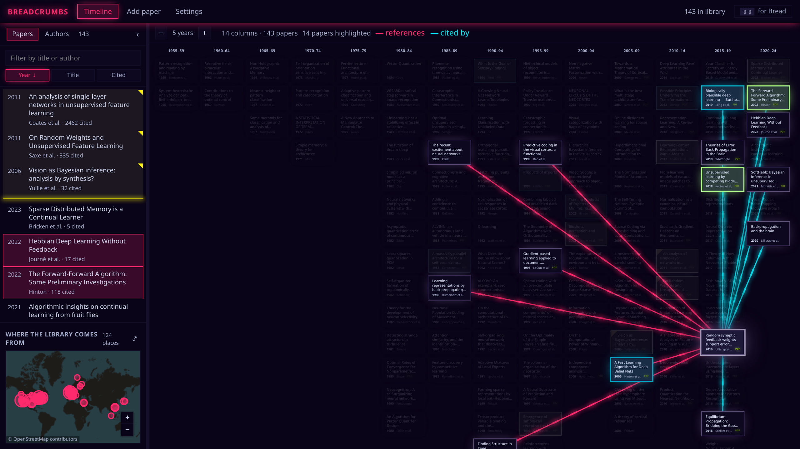
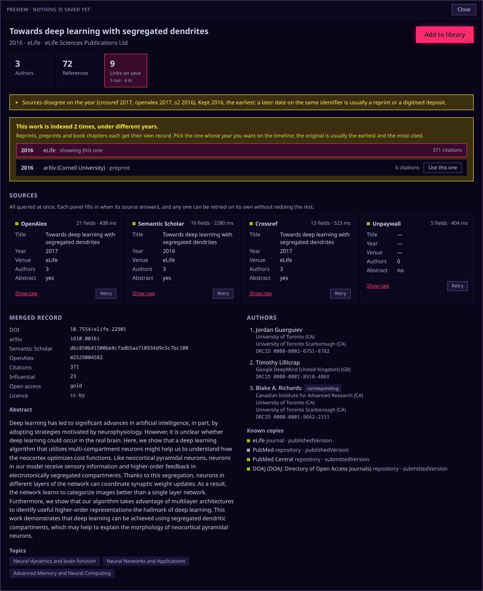
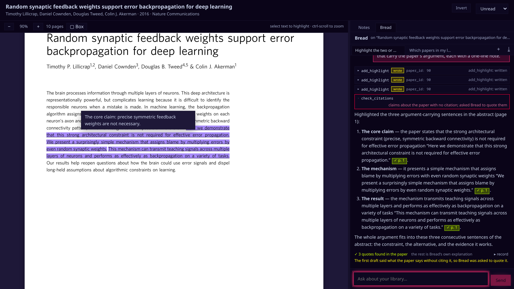
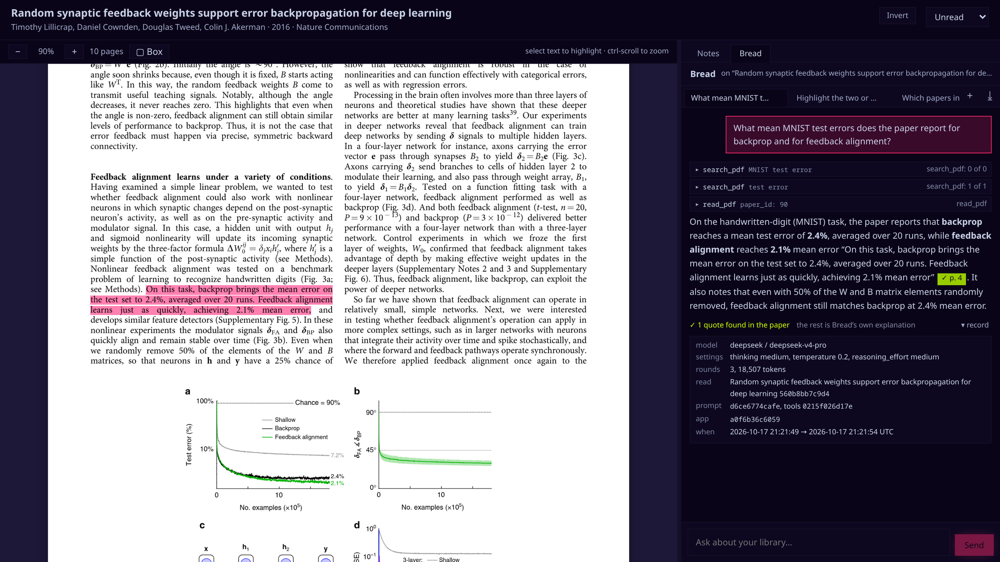
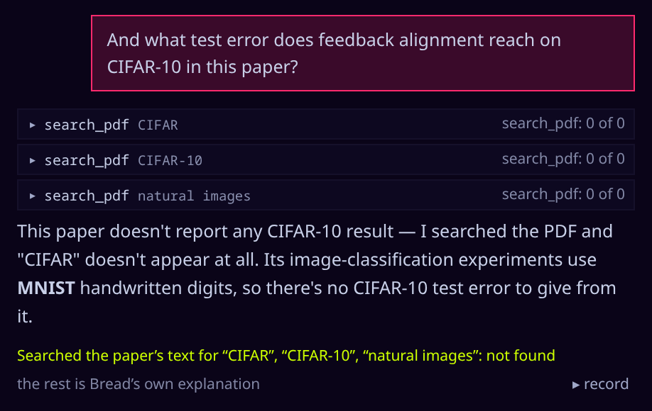

# Breadcrumbs

A local tool for studying a body of literature. It keeps papers, their
references, your notes and highlights in a SQLite database on your machine, and
lays the library out on a time grid so you can see how the work developed.

Papers are added one at a time, by you. Adding one records the identifiers of
everything it cites but creates no other papers; when you later add one of
those, the link appears on its own.

**Bread**, the research assistant built in, reads with you, and is built to be
checkable:

- **Checked quotes.** It may explain from what the model knows, but when it says
  what a paper says, it quotes the paper. The server finds every quote word for
  word in the PDF before the answer is shown; it is a text search, not another
  model. Papers it suggests are checked too: each identifier is looked up and
  its real title compared with the one given.
- **Labelled answers.** Each answer says which kind of statement it makes: the
  paper's, quoted and checked; the library's, from its records; or Bread's own.
- **A record of every turn.** The model that answered, the prompt it saw and
  the PDFs it read are kept with their hashes.
- **Measured behaviour.** How often it is right, cites, and admits a gap is
  scored on [questions with known answers](eval/README.md).

[How it works](#what-it-says-and-what-it-checked).



**[Watch the two-and-a-half-minute tour](https://youtu.be/FB81vicyklU)**: the
grid, a paper and its author, Bread on the library, then reading. It covers
highlighting, asking about a passage, answers whose quotes are checked against
the PDF, a question the paper cannot answer, and Bread marking the page itself.

## Status

Built for my own use, and still changing often. The schema, the commands and the
layout all move without notice, and migrations are written for my library rather
than for anyone else's. Treat it as something to read and take ideas from rather
than something to depend on.

If you do run it, keep a copy of `library.db` before pulling.

## Install and run

```bash
./breadcrumbs install    # dependencies, both halves
./breadcrumbs run        # http://127.0.0.1:8000
```

`run` builds the frontend and serves it from the backend, so only one process
runs. For development, `dev` runs the backend and Vite with hot reload on both;
open http://localhost:5173.

To read without a terminal, `./breadcrumbs shortcut` adds two entries to the
app menu (rofi, GNOME, KDE, anything that reads `.desktop` files).
**Start Breadcrumbs** starts the server in the background if it is not running,
rebuilding first if the frontend changed, and opens it in your browser. **Stop
Breadcrumbs** stops it. Either one reports through a desktop notification when
something goes wrong. From a terminal they are `./breadcrumbs open` and
`./breadcrumbs stop`, and the server's output is in
`$XDG_RUNTIME_DIR/breadcrumbs/server.log`. The entries hold this checkout's
path, so re-run `shortcut` after moving it; `shortcut --remove` takes them out.
Stop the background server before `dev`, which needs the same port.

`./breadcrumbs --help` lists every command, and each takes `--help` of its own.
Commands that serve take `--host` and `--port`; `HOST`, `PORT` and `PAGES` are
read from the environment too.

Your library lives in `~/Breadcrumbs`, or wherever `BREADCRUMBS_HOME` points:
`library.db` plus `pdfs/` and `authors/`. Notes and highlights are rows in the
database, not files.

## Settings

Two things are worth filling in before adding papers:

- **Contact email.** Sent to OpenAlex, Crossref and Unpaywall. Raises rate
  limits and is required by Unpaywall.
- **OpenAlex API key.** Free, from [openalex.org/pricing](https://openalex.org/pricing).
  Without one you share a small anonymous daily allowance, roughly a hundred
  requests. A key gets $1/day: a single record is free, a filtered list costs 1,
  a title search 10. Importing 130 papers cost about 900.

Optional:

- **Semantic Scholar key.** Needs an institutional application. Without it S2
  is skipped when it throttles and OpenAlex supplies references instead.
- **Institution proxy.** An EZproxy/OpenAthens prefix, used to build publisher
  links that go through your subscription.
- **AI keys.** A provider and a search provider (Brave or Tavily) for the
  assistant. Providers are Anthropic, OpenAI, OpenRouter, Gemini and DeepSeek;
  each lists its own models, so the picker shows what your key can reach rather
  than a hardcoded list.

## The grid



Every paper on one screen, in fixed columns of N years. A card's column depends
on its year alone, so nothing moves when a panel opens or a paper is selected.

- `− 5 years +` sets the interval, 1 to 50.
- Empty intervals keep their column, so width measures elapsed time.
- Newest at the top within a column.
- Scroll to zoom, drag to pan, middle-click a card to open it in its own tab.

Hovering or pinning a paper draws its links: magenta to the papers it
references, cyan to the papers that cite it. The papers it links to are lit
in the list on the left as well.

Left alone for fifteen seconds, the grid tours itself. It lights a paper on
screen as though hovered, then another every three seconds, and any input stops
it. It holds off while a paper or author is open in the side panel.

## Panels

**Left.** Papers or authors, filterable, sortable by year, title or citation
count. Below it, a map of author affiliations for whatever is in focus.

**Right.** The selected paper: status, authors, DOI, abstract, your note, its
marked passages, and two tabs. The note renders as Markdown with LaTeX;
double-click it to edit the source. The first is the full reference list, with a
filter for the ones you do not hold; the second is the papers in your library
that cite it. Papers you do
not have can be previewed in place without saving anything.

Papers and authors can be starred.

## Adding papers

Paste a DOI, arXiv id, OpenAlex id or S2 hash, or search by title. Every lookup
queries all sources at once and streams results, showing a panel per source with
a Retry button for any that fail. Nothing is saved until you press save.

The same work is often indexed several times under different years: a journal
article, a book chapter, a later reissue. The Add screen lists every record it
finds and flags when an earlier one exists, so you can pick before saving.



The same preview opens from anywhere a paper you do not hold appears: a
reference, an author's other work, or a paper Bread suggests.

| Source | Supplies | Key |
|---|---|---|
| OpenAlex | identity, authors, institutions, topics, references | free key, advised |
| Crossref | publisher metadata, licence, title search | none |
| Semantic Scholar | search suggestions, influential-citation count, fallback | rarely needed |
| Unpaywall | open-access PDF links | email required |
| arXiv | preprint PDFs, title search | none |

Only references are fetched, not citing papers. A bibliography is finite and can
be had in full; "who cites this" runs to tens of thousands for well-known work,
so any cap on it stores an arbitrary slice. Within your library nothing is lost:
if you hold both papers, the citing one's bibliography carries the edge, and the
graph draws it from both sides.

## PDFs

Open-access PDFs download automatically, trying every legal location rather than
only the one Unpaywall ranks first. arXiv is searched by title as well, since a
paper behind a paywall often has the author's manuscript there.

For paywalled work you get the publisher page, a PubMed record where one exists,
and the publisher page through your institutional proxy if you set one.
**Add PDF** attaches a file you already have.

There is no pirated-source integration.

## Reading



The reader opens in its own tab: PDF on the left, and on the right two tabs,
your notes and Bread.

- Select text to highlight it, attach a note, or **Add to context** to hand
  the passage to Bread.
- **Box** in the toolbar draws a rectangle instead, for scanned PDFs with no
  text layer. It is offered automatically when a page has no text.
- Hovering a highlight shows its note.
- The Notes tab holds your note on the paper, the PDF's own sections, and
  every highlight. Click one to jump to it.
- Ctrl-scroll zooms the page. **Invert** darkens it for reading at night.

Highlights are stored as fractions of the page with the page size alongside, so
they survive re-downloading the PDF and render at any zoom.

## Authors

Each author has a biography, portrait, affiliations, their papers in your
library, and their wider output from OpenAlex. Identity is checked through
Wikidata rather than name matching, and lookups are cached including misses.

OpenAlex splits prolific authors across several records, so `dedupe_authors`
merges them; a merged author keeps every id it answered to, and papers arriving
under an old id resolve to it rather than recreating the duplicate.

## The assistant

Bread: one assistant with every capability as a tool. Tap Shift twice anywhere
to open it. In the reader it is the second tab, and the same shortcut switches
to it.

It reads your papers, authors, links and notes, searches the web, and reads
the open PDF. It writes:

- notes, highlights and links
- reading statuses
- author homepages, biographies and portraits
- PDFs, attached from a URL

It cannot add papers. It proposes one and you decide: a suggestion is a button
in the answer, and pressing it opens the paper's [preview](#adding-papers),
fetched from the sources there and then, with nothing saved until you add it.

Suggestions are checked like quotes. Before the button appears, the identifier
Bread gave is looked up, and the title it really has is compared with the title
Bread wrote. One under another paper's identifier loses its button, says what
that identifier really is, and sends Bread back once to find the right one.
Making this README is how that check came about: asked for a follow-up to
feedback alignment, Bread wrote an arXiv id that belongs to a paper on
Chern-Simons theory.

Tool calls stream into the conversation as they happen, so a wrong action can be
caught while it runs. SQL access is read-only through a separate connection, not
a pattern check.

### What it says, and what it checked

Bread is an assistant, not a retrieval tool: it explains, connects and draws on
what the model knows, and that is allowed. What is not allowed is for the
model's own knowledge to look like the paper's. So every answer says which kind
of statement it is making.


| Kind | The line under the answer | What backs it |
|---|---|---|
| What a paper says | ✓ 2 quotes found in the paper · the rest is Bread's own explanation | each quote, found word for word in the PDF by the server |
| What your library says | From your library's records | the library's own database, read through tools |
| What Bread knows | Bread's own knowledge: nothing was looked up | nothing: it is the model's explanation, marked as such |

#### How a quote is checked

When Bread says what a paper says, it writes the exact words inside a citation
link. `128` is the paper's id in your library:

```
[p. 5](cite:128 "gets 1.36% test errors on MNIST after 60 epochs")
```

After it answers, and before you see it, the server:

1. finds every such link and takes out the paper id and the quoted words
2. opens that paper's PDF and reads the text of every page
3. reduces both to lowercase letters and digits, so line breaks, hyphenation,
   ligatures and punctuation make no difference
4. searches for the quote, page by page

Found, it becomes a **✓ chip** showing the page it is really on; click it and
the reader opens at the passage. Not found, it is struck through, not hidden.
No model takes part: it is a text search, so the same answer checked twice gets
the same verdict, and a chip cannot be faked by the model writing one.



What the check cannot do, and what covers it:

- **Plain prose has nothing to search.** If Bread states a fact without a
  citation, the label calls it Bread's own explanation. An answer that says
  what a paper says ("the authors report…", "(p. 3)") but cites none of it is
  sent back once to quote it, and the reader screenshot above shows exactly
  that: a `check_citations` step, then three checked quotes.
- **A found quote proves presence, not support.** The words are in the paper;
  whether they back the sentence is for the reader to judge, one click away.
  The [evaluation](eval/README.md) measures how often they do.
- A quote whose words the sentence does not already say is shown before its
  chip, so a fact never hides inside a tooltip.

When the paper does not contain the answer, Bread says so, and the line under it
shows the server's own evidence: the literal searches of the paper's text that
found nothing.



Every turn is recorded: the system prompt as sent (with the page you were
reading), the model the provider reports serving each round, the settings sent,
a hash of the tool definitions, the app's commit, the SHA-256 of every PDF read,
tokens, and the verdict on each citation. **record** under an answer shows it,
and **⤓** downloads the whole conversation with its record as JSON. A model
cannot be re-run to the same answer, so this is what reproducibility means here:
being able to see exactly what produced an answer.

Some facts are the server's to establish, not the model's:

- A homepage is marked verified only if the server fetched that page during the
  turn and found the author's name on it. The model can no longer say so itself.
- Text Bread adds to your notes is set apart as a `[!bread]` callout with the
  date and model, so it stays distinguishable from your own writing.
- Web pages and search results reach the model marked as material to read,
  never instructions.

### Passage search

Every stored PDF is cut into passages of a paragraph or two, never crossing a
page, and searched two ways at once:

- by wording, through SQLite full-text search
- by meaning, through a small embedding model (`bge-small-en-v1.5`) that runs
  on your CPU

The two rankings are fused. Bread uses it to find where a paper says something
and which papers in the library discuss something, and each hit names the page
it can be cited from. Reference lists are left out.

New PDFs are indexed on their own. The model is downloaded once (about 65 MB)
into `~/.cache/breadcrumbs/models`, and nothing leaves the machine.
`./breadcrumbs index` brings a library up to date by hand, and Settings → AI
shows how much is covered.

### Evaluation

`eval/` holds 42 questions about nine papers in this library. Each has a gold
answer, the facts a correct answer must state, and evidence quotes verified
against the PDFs. Nine of them are questions the paper cannot answer, where the
right response is to say so.

`./breadcrumbs eval` scores retrieval for free, and the whole assistant on any
model. [eval/README.md](eval/README.md) explains the method and its limits, and
[eval/RESULTS.md](eval/RESULTS.md) has the numbers.

Configure under Settings → AI. Anthropic, OpenAI, OpenRouter, Gemini and
DeepSeek are all supported; the model picker is a combobox that matches tokens
independently, so `gpt 4o` and `4o gpt` both find `openai/gpt-4o`.

Only OpenRouter routes: for it you can pin the upstream provider, with endpoints
listed cheapest-first and fallbacks turned off. Everyone else serves their own
models, so the choice is hidden.

Claude is the one provider that does not speak the OpenAI shape, so it goes
through the official SDK rather than the shared HTTP client. Reasoning maps to
whichever form the model takes: current models think adaptively and take an
effort level, older ones a fixed token budget.

## Publishing a read-only copy

`./breadcrumbs pages` freezes the library into `./site`, four JSON files and a
reader built against them, with no backend or database. Any static host will
serve it.

```bash
./breadcrumbs pages
python3 -m http.server -d site 8080
```

Everything that writes is removed: no adding, no settings, no assistant, no
editing. Papers, authors, references, links and your notes are all readable.

Left out on purpose: **PDFs**, which belong to their publishers, and **settings
and conversations**, which hold your API keys. Only the routes in
`export_static.ROUTES` are written. The export makes no network requests.

Edit `pages.json` first. It sets the repository link and the wording of the
"what is this?" panel:

```json
{
  "repo_url": "https://github.com/YOUR-USERNAME/Breadcrumbs",
  "owner": "Ada",
  "title": "",
  "intro": ""
}
```

It ships as data, so changing it means re-running `pages`, not rebuilding.

An author's wider output is skipped, since listing it costs two live OpenAlex
requests per author. Pass `--with-works` for it.

While `dev` runs, the published copy is also served at
http://localhost:5173/readonly/.

## Maintenance

All of these take `--dry-run`.

| Command | Does |
|---|---|
| `./breadcrumbs backfill` | Re-fetches every paper's full reference list, then relinks. |
| `./breadcrumbs redate` | Fixes years taken from a reprint or digitised deposit, using the earliest a source reports. |
| `./breadcrumbs dedupe-authors` | Merges author rows that are the same person. |
| `./breadcrumbs index` | Cuts new or changed PDFs into passages and embeds them. `--rebuild` redoes all. |

`redate` and `backfill` depend on sources that rate-limit; re-run until they
report nothing left unverified.

`./breadcrumbs check` typechecks the frontend, imports the backend and runs its
tests.
`clean` removes build output, `wipe` also removes installed dependencies.

## Layout

```
backend/src/backend/
  schema.sql    tables, indexes, seeded link types and shelves
  db.py         connections, settings, migrations
  ids.py        identifier normalisation, the basis of link matching
  sources/      one adapter per API, plus a rate-limited HTTP client
  store.py      upserts, link resolution, author merging, deletion
  ingest.py     fetch, merge, preview, save
  pdftext.py    page text, outline, quote to rectangles, the strict quote check
  passages.py   passage index: chunking, embeddings, hybrid search
  ai/           agent loop, tools, skills
    citations.py  checking every quote an answer cites
    provenance.py the record of each turn
  evals.py      the evaluation harness behind ./breadcrumbs eval
  api.py        HTTP routes
backend/tests/  the deterministic parts of grounding, without a model
eval/           questions, gold evidence, saved runs and results
demo/           the tour video, the GIF and the screenshots above, recorded
                from the live app (see demo/README.md)
frontend/src/
  api.ts                    typed client, and the static-export reader
  components/Timeline       the binned grid
  components/timelineLayout binning, card sizing, type metrics
  components/AddPaper       search, per-source preview, then save
  components/Reader         PDF, highlights, notes, assistant
  components/Settings       keys, fetch behaviour, source health check
```

Every request goes through one client with a per-host token bucket and
exponential backoff, so a source that throttles slows only itself.
